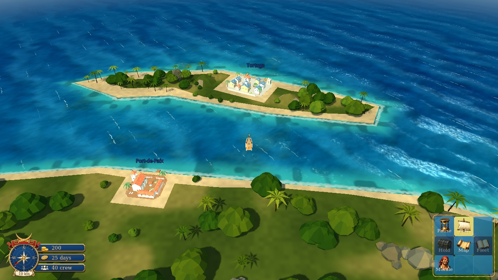
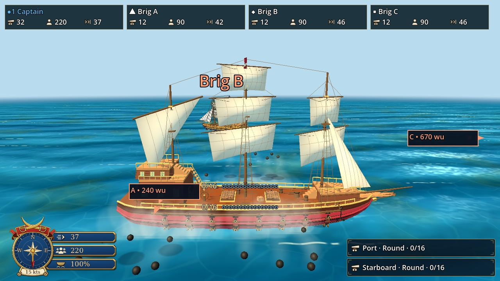
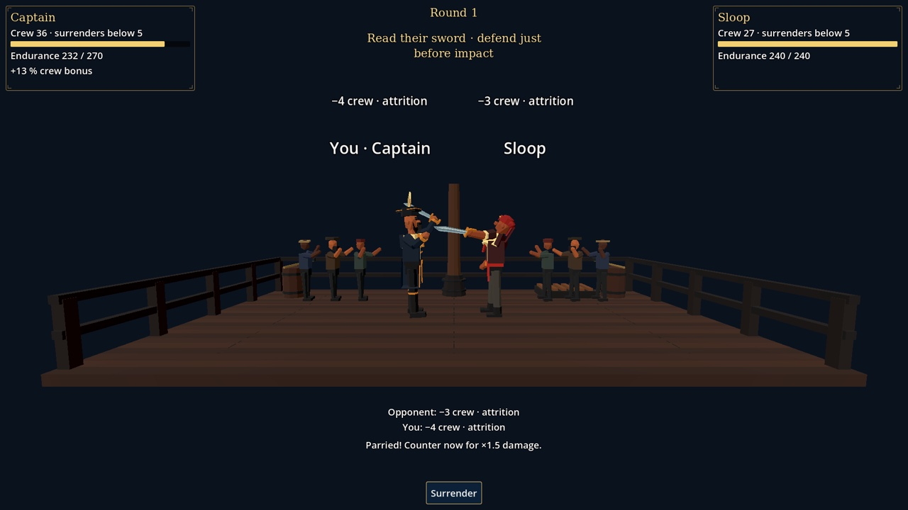
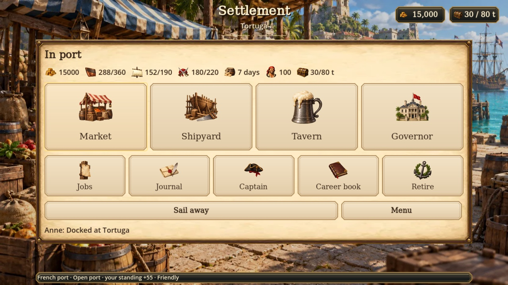
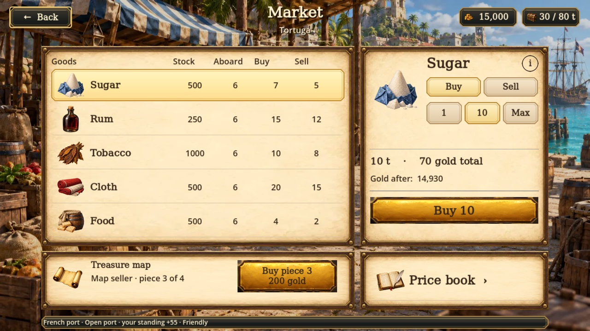
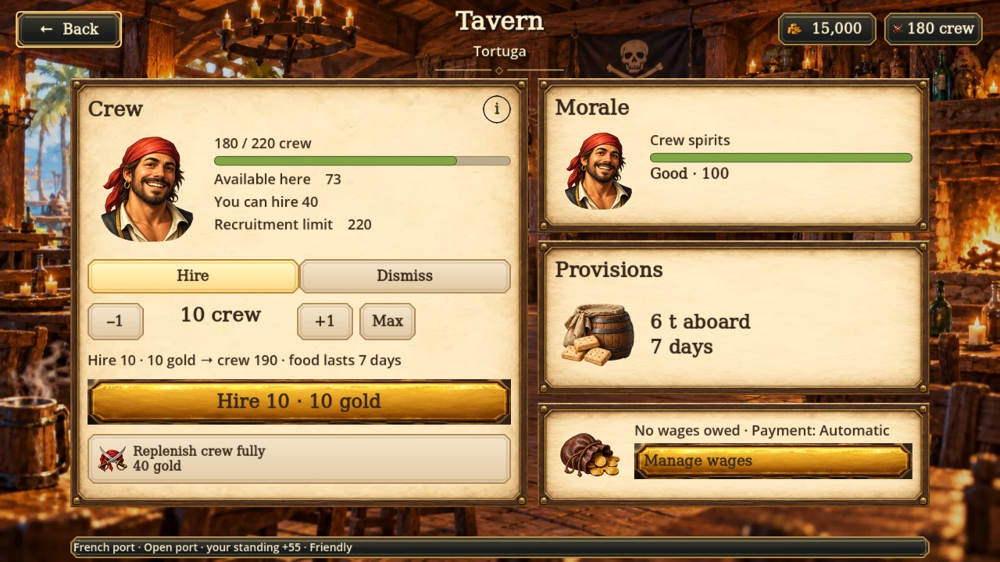
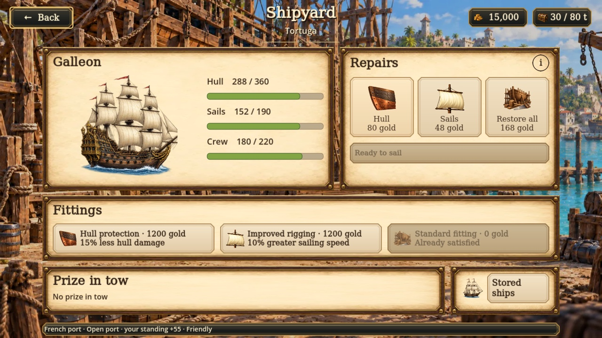

  

<h1 align="center">Tortuga</h1>

  A modern remake of <em>Sid Meier's Pirates!</em> — sail, trade, fight and plunder the Caribbean, alone or with friends.

  
  
  
  

  

## Overview

Tortuga is an open-ended pirate adventure in the spirit of the 2004 *Pirates!*: you are a captain in the Caribbean of the 1660s, free to trade, privateer, hunt rivals, chase treasure and build a career however you like. It plays fully **offline**, and the same campaign also runs as a **shared world** on a dedicated server where up to four captains sail, cooperate and compete in one Caribbean.

The game is built in Godot 4.7 by a solo developer with AI assistance. The source is private; this repository publishes the **test builds**. Expect rough edges, and expect a new campaign to be required between some versions.

## Goals

- **Keep the spirit of *Pirates!*** — a captain's life of short adventures inside a longer career, with readable tactical choices and consequences that connect everything.
- **Classic, modernized** — overhead sailing, top-down naval battles, light swashbuckling tone and modern usability.
- **Fast, small, quick to load** — responsive controls, smooth frame pacing, a tiny download and short waits to the action, on modest hardware.
- **Offline and shared** — a complete single-player game, plus a small-group shared campaign for independent captains.
- **Signature activities, one at a time** — boarding duels and treasure hunting are in; other classic minigames are judged on their merits.

## What you can do today

| | |
|---|---|
| **Sail** | A 3D Caribbean seen from a pitched follow camera, with wind, tacking, 22 ports and islands you can go ashore on. |
| **Fight** | Naval battles with eight hull types, round, chain and grape shot, smarter AI captains and timed 3D boarding duels. |
| **Trade & plunder** | Buy low and sell high across port markets, capture prizes, intercept the Spanish treasure fleet and hunt named rivals. |
| **Run a crew** | Hire in taverns, keep them fed and paid, manage morale, repair and refit at the shipyard. |
| **Build a career** | Commissions and standing with four nations, jobs and missions, treasure maps, skills and titles, retirement and a career book. |
| **Play together** | A persistent shared world on a dedicated server, with a shared pause and server-side saving. |

## Screenshots

<table>
  <tr>
    <td width="50%"> A galleon fires both broadsides.</td>
    <td width="50%"> Boarding duel on deck.</td>
  </tr>
  <tr>
    <td width="50%"> Docked at Tortuga.</td>
    <td width="50%"> Buying sugar at the market.</td>
  </tr>
  <tr>
    <td width="50%"> Hiring crew in the tavern.</td>
    <td width="50%"> Repairs and fittings at the shipyard.</td>
  </tr>
</table>

## Download

Grab the latest build from [Releases](https://github.com/dnldxn/tortuga-releases/releases/latest), unpack it and run it.

| Platform | File |
|---|---|
| Windows | `Tortuga-0.N-windows.zip` |
| macOS | `Tortuga-0.N-macos.zip` |
| Linux (x86_64) | `Tortuga-0.N-linux.tar.gz` |
| Dedicated server (linux-arm64) | `tortuga-server-linux-arm64.tar.gz` (+ `.sha256`) |

The game updates itself: **Check for updates** in the main menu downloads and verifies the newer pack, then restarts. The `.pck` files and `update.json` on each release are for that updater. Clients and servers must run the same version to play together.

## Feedback

These are test builds, so saves from older versions may be refused and a fresh campaign asked for; the release notes say when. Found a bug or have an idea? [Open an issue](https://github.com/dnldxn/tortuga-releases/issues).
