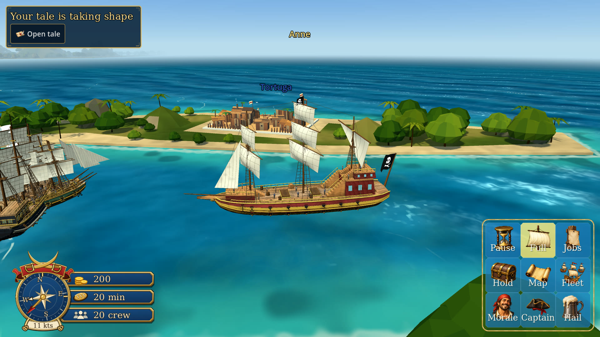
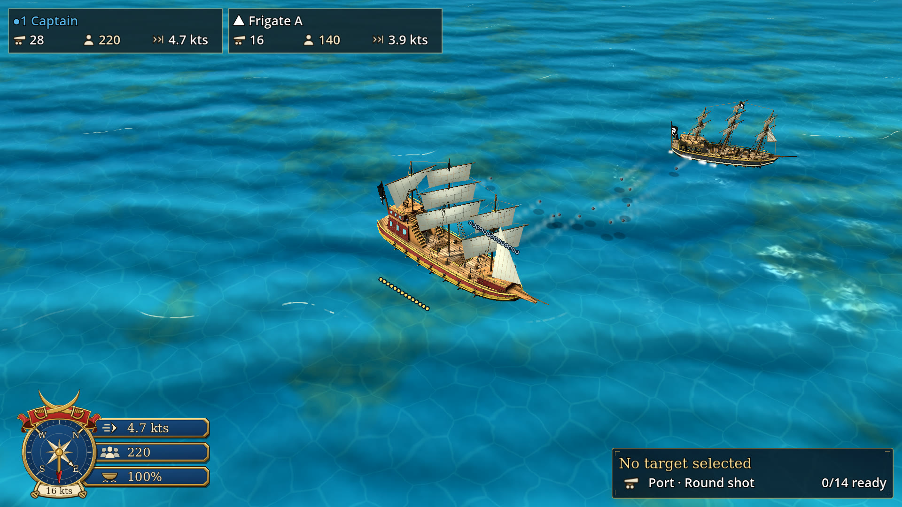
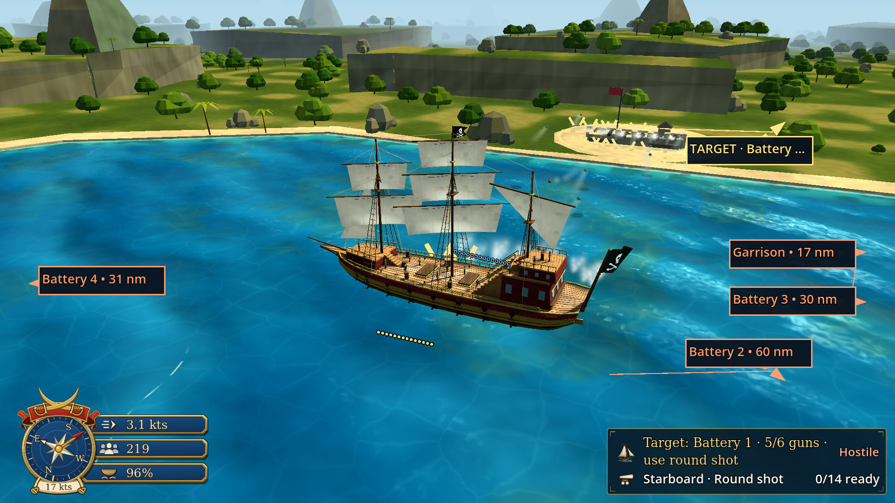
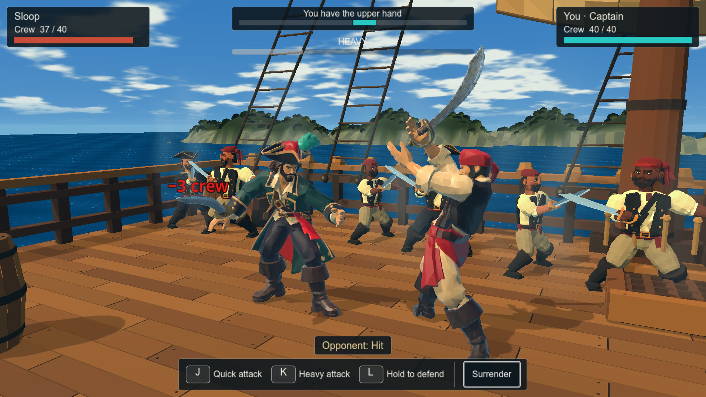
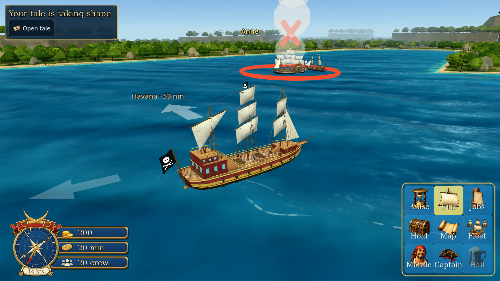
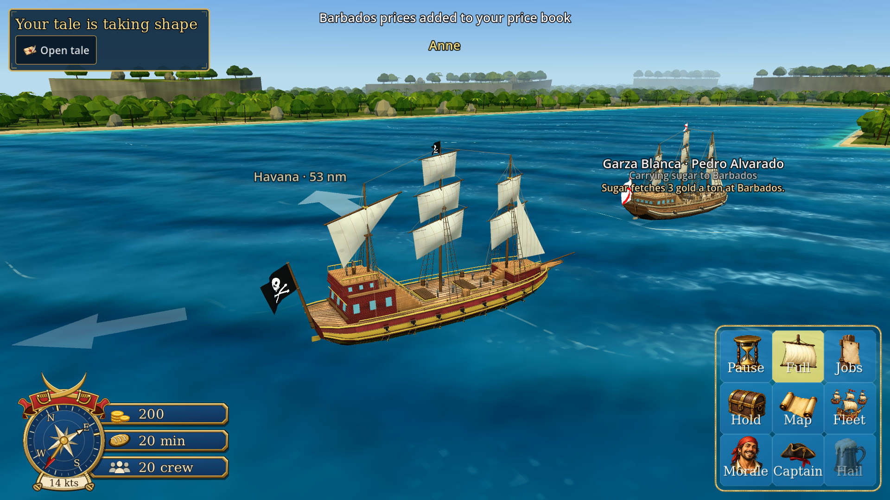
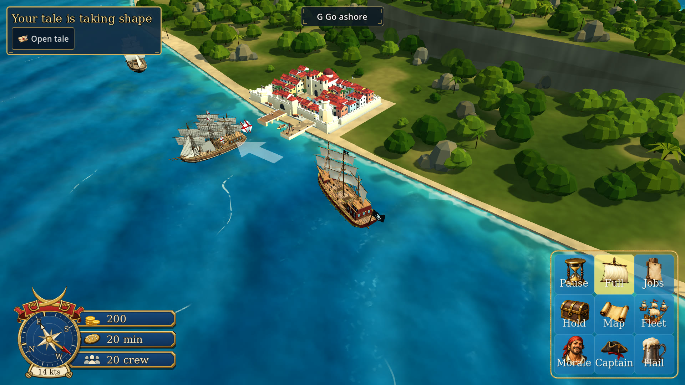
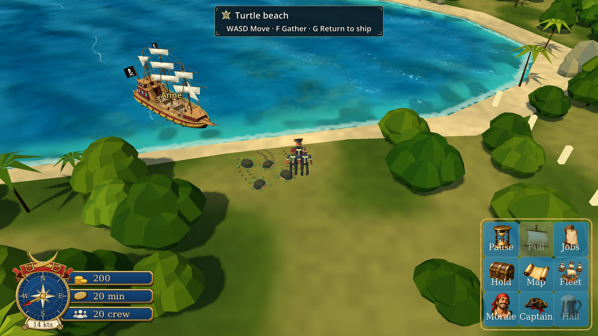
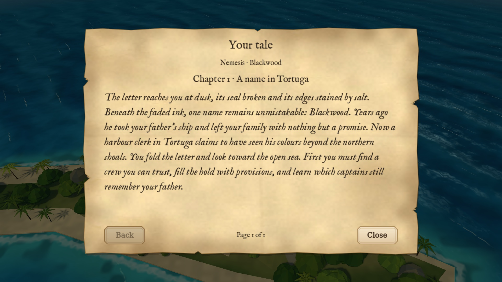
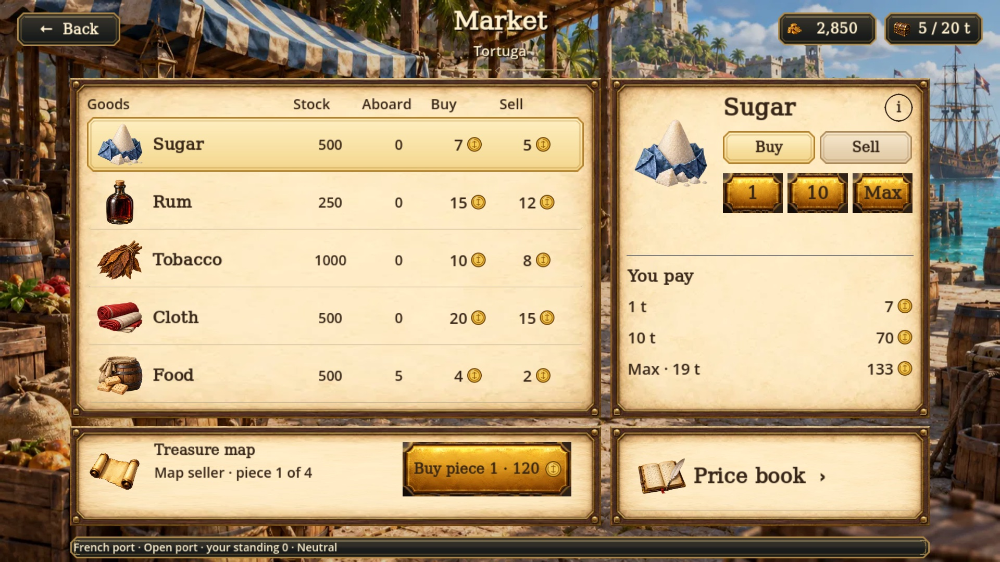

  

<h1 align="center">Tortuga</h1>

  A pirate adventure inspired by <em>Sid Meier's Pirates!</em> — sail, trade, fight and plunder the Caribbean, alone or with friends.

  
  
  
  

  

## Overview

Tortuga is an open-ended pirate adventure in the spirit of the 2004 *Pirates!*: you are a captain in the Caribbean of the 1660s, free to trade, privateer, hunt rivals, chase treasure and build a career however you like. It plays fully **offline**, and the same campaign also runs as a **shared world** on a dedicated server where up to four captains sail, cooperate and compete in one Caribbean.

The game is built in Godot 4.7 by a solo developer with AI assistance. The source is private; this repository publishes the **test builds**. Expect rough edges, and expect a new campaign to be required between some versions.

## Goals

- **Keep the spirit of *Pirates!*** — a captain's life of short adventures inside a longer career, with readable tactical choices and consequences that connect everything.
- **Classic, modernized** — overhead sailing, top-down naval battles, light swashbuckling tone and modern usability.
- **Fast, small, quick to load** — responsive controls, smooth frame pacing, a tiny download and short waits to the action, on modest hardware.
- **Offline and shared** — a complete single-player game, plus a small-group shared campaign for independent captains.
- **Signature activities, one at a time** — boarding duels and treasure hunting are in; other classic minigames are judged on their merits.

## Latest additions

[**v0.49**](https://github.com/dnldxn/tortuga-releases/releases/tag/v0.49) caps a big run of updates since v0.42 that brought the Caribbean to life:

- **Storm a harbour** — a new Practice harbour assault: pick a port size, trade broadsides with up to four shore batteries, silence their guns, then land and storm the quay for a duel with the commander.
- **A living sea** — computer ships now fight each other across the map. Spot a battle by its column of smoke and gunfire, then help the victim, join the raiders or sail on. Sunken ships leave floating wreckage with cargo and survivors for the first captain to reach it.
- **True tavern news** — taverns report who sank or took whom and where, and where a well-laden pirate was last seen.
- **Hail passing ships** — ask a captain where they are bound, add their prices to your price book and pick up jobs at sea.
- **Sharper swordplay** — learn each opponent’s rhythm, break guards with heavy strikes and win the upper hand to help your crew in the boarding fight.
- **Smarter, bolder captains** — escort jobs face pirate raids, navy allies fight beside you, and computer captains plan better, stand their ground more often and visibly flee when beaten.
- **Better-looking ships and seas** — shadows, warmer timber and more depth, plus working boats, wildlife and lookout calls along the coast.

## What you can do today

| | |
|---|---|
| **Sail & explore** | A 3D Caribbean with wind and tacking, 40 ports across four nations, and a zoomable chart that reveals coasts, landmarks and settlements as you explore. Hail passing ships, watch working boats and wildlife along the coast, and visit the hand-made Havana and Tortuga waterfronts. |
| **Fight** | Naval battles with eight hull types and round, chain and grape shot. Line up your broadsides, outmanoeuvre enemy captains, board for a 3D sword duel, or escape a losing fight and risk pursuit. Join fights between computer ships, and practise assaulting a fortified harbour. |
| **Trade & plunder** | Buy low and sell high across port markets with a price book, capture prizes, keep ships as escorts, guard convoys from raiders, salvage wreckage, intercept the Spanish treasure fleet and hunt named rivals in their home waters. |
| **Go ashore** | Land a party, follow treasure maps and dig up buried gold. Gather provisions at supply stops, salvage cargo, search camps, rescue castaways and pick up bottles with map scraps. |
| **Run a crew** | Hire in taverns, keep your crew fed and paid, manage morale and wages, and inspect your hold and fleet from the captain’s quarters at sea. Repair, refit and store spare ships in port. |
| **Build a career** | Follow a personal storyline with chapters, rivals, branching choices and an ambition to work toward. Take commissions and contracts, improve skills, earn titles, retire and pass command to the next generation. The Journal keeps your tale, jobs and treasure maps together. |
| **Play together** | Sail offline or join a persistent shared world on a dedicated server for up to four captains, with a shared pause and server-side saving. |

## Screenshots

Captured in-game on macOS using staged campaign and battle scenes.

<table>
  <tr>
    <td width="50%"> Trade broadsides with an enemy frigate.</td>
    <td width="50%"> Silence the shore batteries in a harbour assault.</td>
  </tr>
  <tr>
    <td width="50%"> Win the upper hand in a boarding duel.</td>
    <td width="50%"> Stumble on a pirate raid and decide whose side you are on.</td>
  </tr>
  <tr>
    <td width="50%"> Hail a passing merchant for news and prices.</td>
    <td width="50%"> Visit Havana’s hand-made waterfront.</td>
  </tr>
  <tr>
    <td width="50%"> Go ashore to provision your ship.</td>
    <td width="50%"> Follow your captain’s tale, chapter by chapter.</td>
  </tr>
  <tr>
    <td width="50%"> Trade goods and keep the hold stocked.</td>
  </tr>
</table>

## Download

Grab the latest build from [Releases](https://github.com/dnldxn/tortuga-releases/releases/latest), unpack it and run it. The v0.49 full downloads are about **80–100 MiB**, including the engine.

| Platform | File |
|---|---|
| Windows | `Tortuga-0.N-windows.zip` |
| macOS | `Tortuga-0.N-macos.zip` |
| Linux (x86_64) | `Tortuga-0.N-linux.tar.gz` |
| Dedicated server (linux-arm64) | `tortuga-server-linux-arm64.tar.gz` (+ `.sha256`) |

On Linux, unpack the archive into the folder where you want to keep the game, then run `bash install-desktop.sh` to add Tortuga and its icon to your applications menu. Run the installer again if you move that folder.

The game updates itself: **Check for updates** in the main menu downloads and verifies the newer pack, then restarts. When possible, only changed game packs are downloaded. The `.pck` files and `update.json` on each release are for that updater. Clients and servers must run the same version to play together.

**Campaigns carry over from v0.46 onward.** Saves from v0.45 and earlier need a new campaign.

## Feedback

These are test builds, so saves from older versions may be refused and a fresh campaign asked for; the release notes say when. Found a bug or have an idea? [Open an issue](https://github.com/dnldxn/tortuga-releases/issues).
