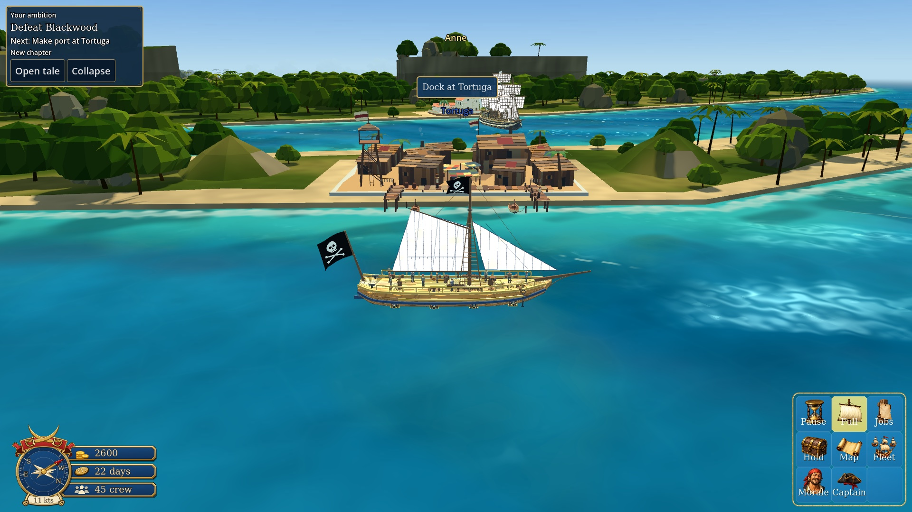
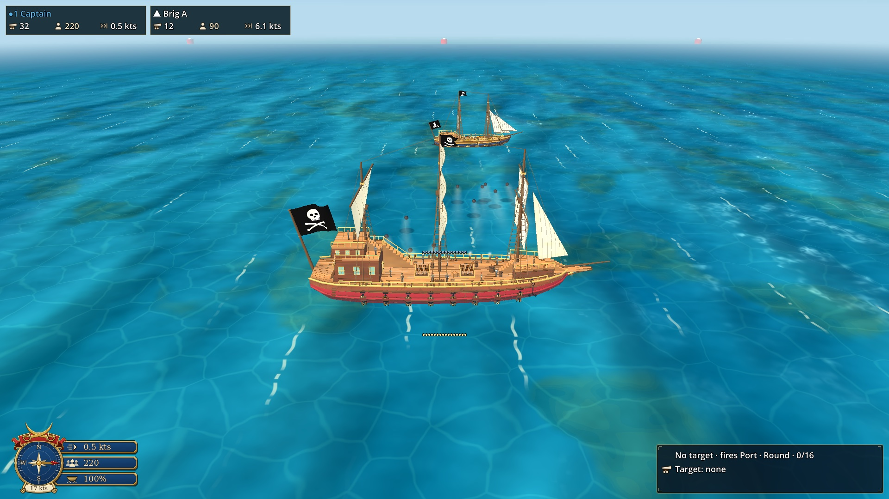
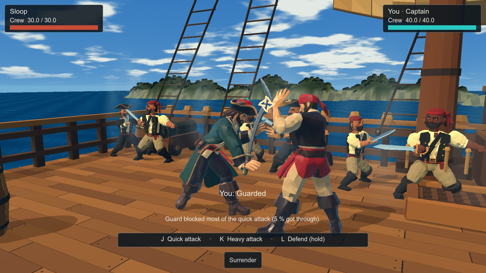
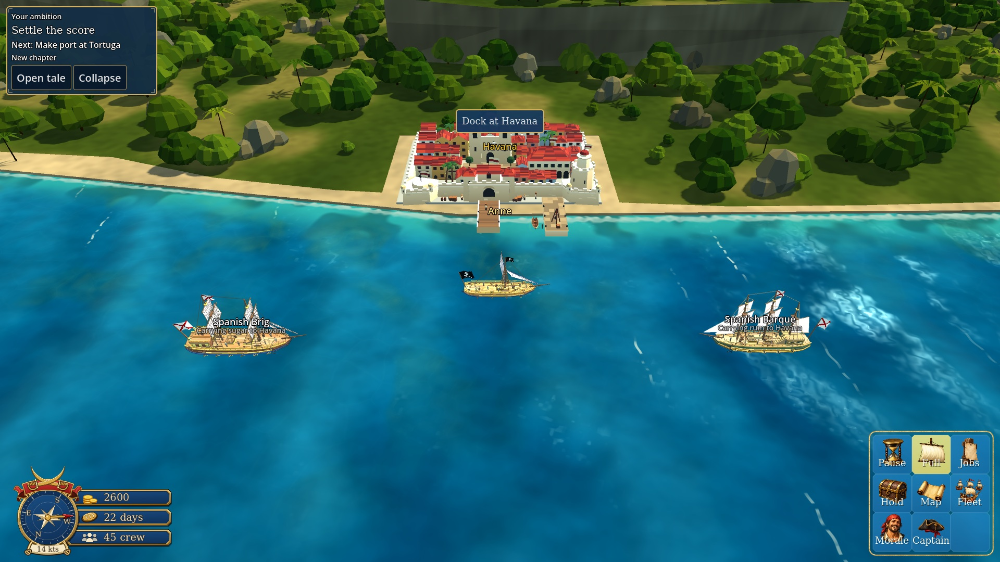
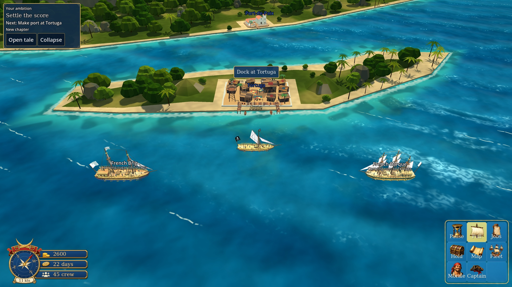
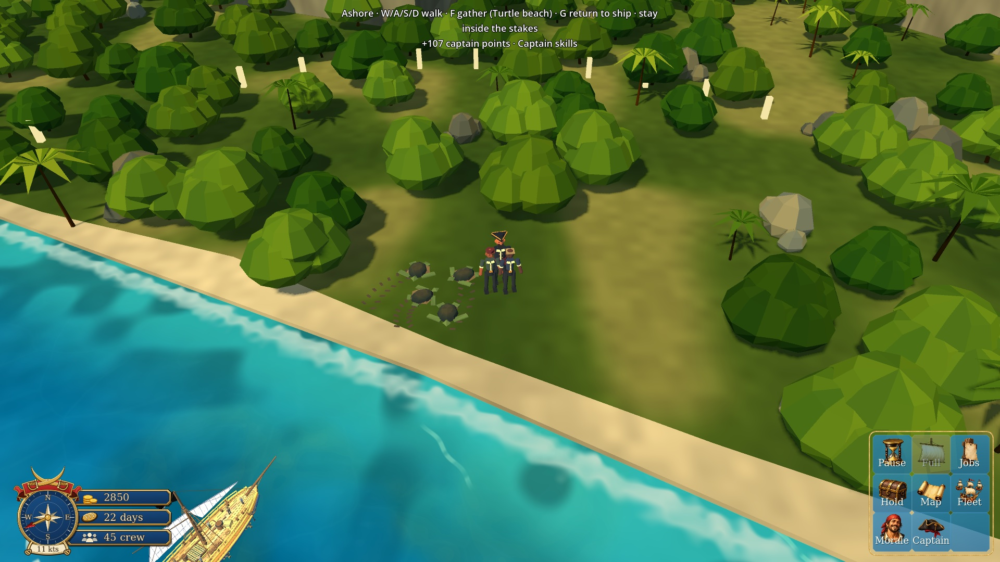
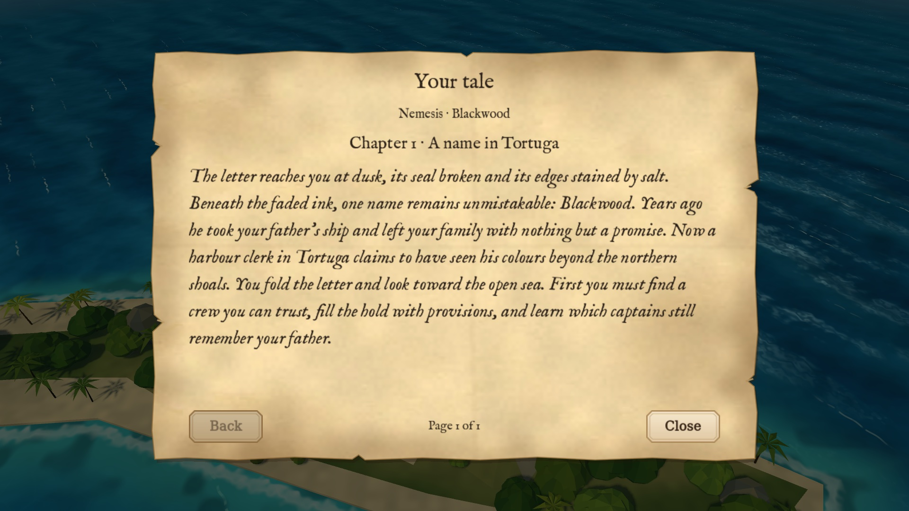
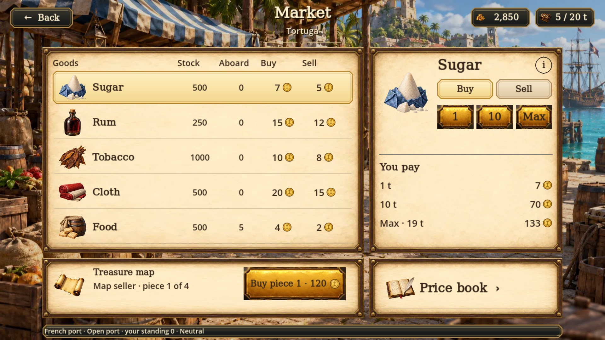

  

<h1 align="center">Tortuga</h1>

  A pirate adventure inspired by <em>Sid Meier's Pirates!</em> — sail, trade, fight and plunder the Caribbean, alone or with friends.

  
  
  
  

  

## Overview

Tortuga is an open-ended pirate adventure in the spirit of the 2004 *Pirates!*: you are a captain in the Caribbean of the 1660s, free to trade, privateer, hunt rivals, chase treasure and build a career however you like. It plays fully **offline**, and the same campaign also runs as a **shared world** on a dedicated server where up to four captains sail, cooperate and compete in one Caribbean.

The game is built in Godot 4.7 by a solo developer with AI assistance. The source is private; this repository publishes the **test builds**. Expect rough edges, and expect a new campaign to be required between some versions.

## Goals

- **Keep the spirit of *Pirates!*** — a captain's life of short adventures inside a longer career, with readable tactical choices and consequences that connect everything.
- **Classic, modernized** — overhead sailing, top-down naval battles, light swashbuckling tone and modern usability.
- **Fast, small, quick to load** — responsive controls, smooth frame pacing, a tiny download and short waits to the action, on modest hardware.
- **Offline and shared** — a complete single-player game, plus a small-group shared campaign for independent captains.
- **Signature activities, one at a time** — boarding duels and treasure hunting are in; other classic minigames are judged on their merits.

## Latest additions

[**v0.42**](https://github.com/dnldxn/tortuga-releases/releases/tag/v0.42) brings more reasons to go ashore and more life to the coast:

- **Provision on shore** — gather food at turtle beaches and fruit groves, or lift your crew’s spirits at a spring. Supply stops empty and refill over time.
- **Discover something unexpected** — salvage washed-up cargo, search abandoned camps, rescue castaways and find treasure-map scraps in bottles. Each discovery can be claimed once before it disappears.
- **Keep your ambition in sight** — a sailing card shows your captain’s next story goal, with useful reminders when you dock and a shortcut to unread chapters.
- **Visit new waterfronts** — Havana and Tortuga have hand-made harbour scenes with boats, workers, flags and other small touches of activity.
- **Enjoy richer landings** — a beached ship, rowing boat, captain and shovel-carrying crew accompany treasure hunts, with a rising chest and shore sounds when you find the prize.

## What you can do today

| | |
|---|---|
| **Sail & explore** | A 3D Caribbean with wind and tacking, 40 ports across four nations, and a chart that reveals coasts, landmarks and settlements as you explore. Rotate and zoom the camera, watch for passing traffic, and visit the new Havana and Tortuga waterfronts. |
| **Fight** | Naval battles with eight hull types and round, chain and grape shot. Line up your broadsides, outmanoeuvre enemy captains, board for a timed 3D sword duel, or escape a losing fight and risk pursuit at sea. |
| **Trade & plunder** | Buy low and sell high across port markets with a price book, capture prizes, keep ships as escorts, intercept the Spanish treasure fleet and hunt named rivals in their home waters. |
| **Go ashore** | Land a party, follow treasure maps and dig up buried gold. Gather provisions at supply stops, salvage cargo, search camps, rescue castaways and pick up bottles with map scraps. |
| **Run a crew** | Hire in taverns, keep your crew fed and paid, manage morale and wages, and inspect your hold and fleet from the captain’s quarters at sea. Repair, refit and store spare ships in port. |
| **Build a career** | Follow a personal storyline with chapters, rivals and an ambition to work toward. Take commissions and contracts, improve skills, earn titles, retire and pass command to the next generation. The Journal keeps your tale, jobs and treasure maps together. |
| **Play together** | Sail offline or join a persistent shared world on a dedicated server for up to four captains, with a shared pause and server-side saving. |

## Screenshots

Captured in-game on macOS using staged campaign and battle scenes.

<table>
  <tr>
    <td width="50%"> A galleon fires a broadside.</td>
    <td width="50%"> Settle a boarding action with a sword duel.</td>
  </tr>
  <tr>
    <td width="50%"> Merchant traffic off Havana’s hand-made waterfront.</td>
    <td width="50%"> Ships trading off Tortuga, with their destinations shown.</td>
  </tr>
  <tr>
    <td width="50%"> Go ashore to provision your ship.</td>
    <td width="50%"> Follow your captain’s tale, chapter by chapter.</td>
  </tr>
  <tr>
    <td width="50%"> Trade goods and keep the hold stocked.</td>
  </tr>
</table>

## Download

Grab the latest build from [Releases](https://github.com/dnldxn/tortuga-releases/releases/latest), unpack it and run it. The v0.42 full downloads are about **80–95 MiB**, including the engine.

| Platform | File |
|---|---|
| Windows | `Tortuga-0.N-windows.zip` |
| macOS | `Tortuga-0.N-macos.zip` |
| Linux (x86_64) | `Tortuga-0.N-linux.tar.gz` |
| Dedicated server (linux-arm64) | `tortuga-server-linux-arm64.tar.gz` (+ `.sha256`) |

On Linux, unpack the archive into the folder where you want to keep the game, then run `bash install-desktop.sh` to add Tortuga and its icon to your applications menu. Run the installer again if you move that folder.

The game updates itself: **Check for updates** in the main menu downloads and verifies the newer pack, then restarts. When possible, only changed game packs are downloaded. The `.pck` files and `update.json` on each release are for that updater. Clients and servers must run the same version to play together.

**v0.42 needs a new campaign:** saves from v0.41 and earlier cannot be continued.

## Feedback

These are test builds, so saves from older versions may be refused and a fresh campaign asked for; the release notes say when. Found a bug or have an idea? [Open an issue](https://github.com/dnldxn/tortuga-releases/issues).
